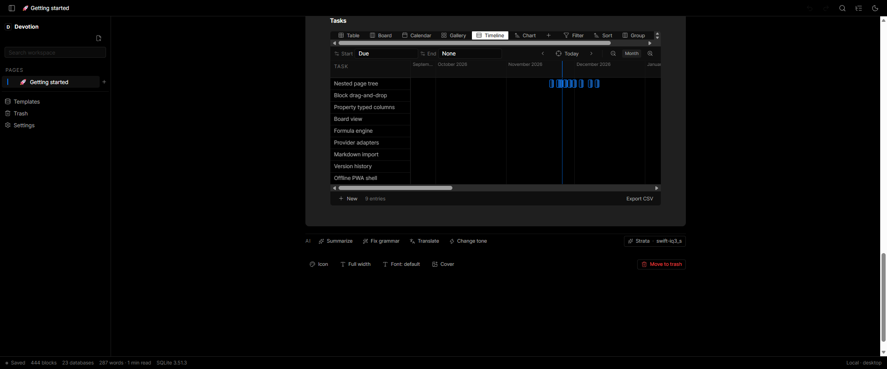
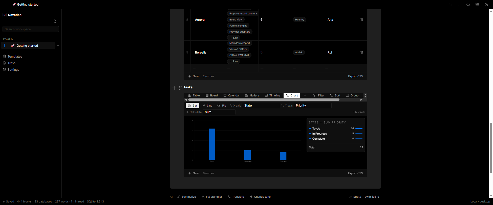
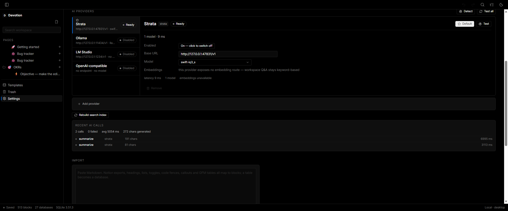

# Devotion

Devotion is a lightweight, free alternative to Notion for personal use. It keeps
most of what makes Notion good: the block editor, tables that work like
databases, views such as board, calendar and timeline, templates, nested pages,
and search. It also connects to AI that runs on your own computer, so nothing has
to leave your machine.

Your notes live in one folder on your computer. No account, no subscription, no
cloud. To back everything up, copy that folder.

It's a personal project. The source is published so you can read it and change
it, and it's free for personal use (not licensed for commercial use; the
[license](LICENSE) at the bottom spells that out in two sentences).


## What you get

- A block editor. Type `/` to add headings, lists, checkboxes, toggles, quotes,
  code, math, images, and columns you resize by dragging the line between them.
- Tables that work like databases. Each column has a type (text, number, date,
  checkbox, dropdown, status, a link to another row, a formula), and every row
  opens like a page you can write in.
- Eight views of the same data: table, board, list, gallery, calendar, timeline,
  chart, and a form you can fill in.
- Fifteen ready-made templates: meeting notes, weekly review, project brief,
  product spec, bug tracker, reading list, content calendar, contacts, OKRs,
  sprint retro, daily journal, recipe, wiki article, habit tracker, goal tracker.
- Search across everything, page history, a trash bin, and undo.
- Export to Markdown, HTML, CSV and PDF. Import from Markdown, including exports
  from Notion.
- Local AI: summarize, translate, fix grammar, change tone, fill in table fields,
  and answer questions about your notes.







## Installing it

You need two free programs, once: **Git** (to download the project) and
**Node.js 24** (to run it). Then the steps are the same every time.

### 1. Install Git

Go to <https://git-scm.com/downloads>, download, install, accepting the defaults.

To check it worked, open a terminal and type:

```
git --version
```

You should see something like `git version 2.52.0`.

On Windows, the quickest way to open a terminal: press the Windows key, type
`cmd`, press Enter. On a Mac, press `Cmd` + `Space`, type `Terminal`, press
Enter.

### 2. Install Node.js 24

Go to <https://nodejs.org> and download the **v24** installer. Run it, accepting
the defaults.

Check it:

```
node --version
```

You should see `v24.something`. If you see `v20` or `v22`, Devotion will not
start. Go back and install v24.

### 3. Download Devotion

In the terminal, go to wherever you keep your projects, then:

```
cd Documents
git clone https://github.com/iulianduminica/Devotion.git
cd Devotion
```

`cd` means "change folder". `git clone` copies the whole project onto your
computer.

### 4. Install what the project needs

Make sure you are inside the `Devotion` folder, then:

```
npm install
```

This takes a minute. It downloads the libraries Devotion is built on.

### 5. Build it

```
npm run build
```

### 6. Start it

```
npm start
```

You should see:

```
  Devotion  →  http://127.0.0.1:8790
```

Open your browser and go to **http://127.0.0.1:8790**. That's it.

To stop, press `Ctrl` + `C` in the terminal. To start again later, run
`npm start` from the `Devotion` folder. You don't repeat steps 1 to 5.

### Optional: start with example notes

To see it filled in, run this **before** `npm start`:

```
npm run seed
```

It creates a demo page showing every block type, plus two example tables.

### Where your notes are kept

In the project folder, at `.data/workspace`: one database file and a media
folder. Copy that folder to back up.

On Windows, `.data` is hidden. In File Explorer, turn on **View → Hidden items**.

## Installing it with Docker

Docker runs the app inside a self-contained box, so you don't install Node.js at
all. Use this if the steps above look like too much.

1. Install **Docker Desktop** from
   <https://www.docker.com/products/docker-desktop/> and start it. On Windows it
   may ask to restart, and it offers WSL 2; accept the default.

2. Open a terminal and download the project:

   ```
   cd Documents
   git clone https://github.com/iulianduminica/Devotion.git
   cd Devotion
   ```

3. Start it:

   ```
   docker compose up --build
   ```

   The first run builds the box and takes a few minutes. When it settles, open
   **http://127.0.0.1:8790**.

4. To stop, press `Ctrl` + `C`. To start again, run `docker compose up` from the
   same folder.

Your notes end up in a folder called `data` next to the project files, so they
survive when the box is rebuilt.

## Turning on AI (optional)

Devotion works with no AI at all. The easy path is **Ollama**:

1. Install Ollama from <https://ollama.com/download>.
2. In a terminal, download one model: `ollama pull llama3.1`
3. In Devotion, open **Settings**, scroll to **AI providers**, press **Detect**.
   It looks for AI programs already running on your computer and offers to add
   what it finds. Press **Add**.
4. Choose the model in the AI bar at the bottom of a page.

LM Studio works the same way, and so does anything that offers an OpenAI-style
address on your own machine.



## How it works, briefly

Pages, blocks and table rows are all stored the same way, as nodes in one tree
inside one SQLite database. That's why a table row can be opened and written in
like a page: it is the same kind of thing.

Search is maintained by the database itself, so it can't drift out of sync with
your notes. Formulas are read and evaluated by a small built-in language, with no
code execution.

The app is one small server plus a browser front end. Node 24 includes the
database engine, so there is nothing to compile and no native tools to install.
It runs the same on Windows, macOS and Linux, and the tests run on all three for
every change.

## For developers

```bash
npm run dev          # hot reload: app on :5175, server on :8790
npm run typecheck    # no type errors
npm run test:all     # eight suites, about 2100 checks
npm run boot:check   # starts the real server and checks that it answers
```

[CONTRIBUTING.md](CONTRIBUTING.md) covers the layout of the code and the parts
that are easy to get wrong.

## A note on safety

Devotion listens only on your own machine, so other people on your network can't
open it. It has one user and no passwords, so don't put it on the internet.
Nothing is uploaded anywhere: the only network requests go to AI programs you set
up yourself, at addresses you typed.

## License

Free for personal, non-commercial use. Use it at home, read the source, change
it, write about it. Please don't sell it, host it for pay, or ship it inside a
commercial product. Details in [LICENSE](LICENSE); the libraries it builds on are
listed in [THIRD-PARTY-NOTICES.md](THIRD-PARTY-NOTICES.md).
