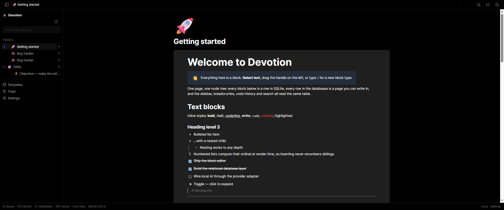
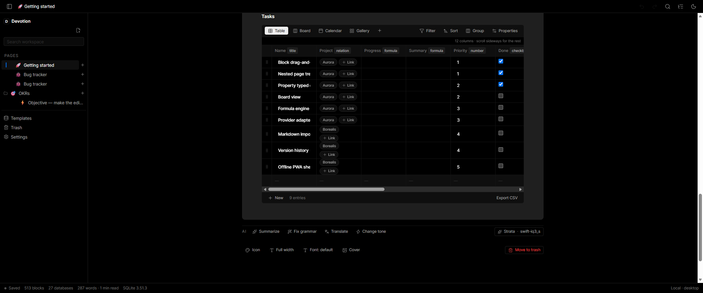
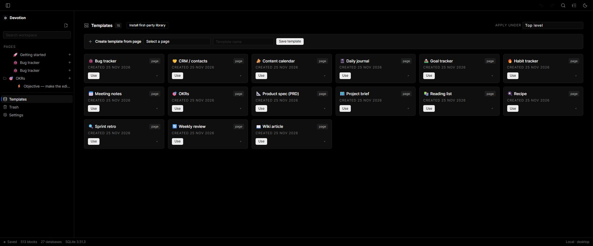

# Devotion

Devotion is a Notion alternative that runs on your machine. Your notes, your
databases, your settings: one SQLite file in one folder, and a media folder next
to it. No account, no subscription, no cloud. To back everything up you copy one
directory.

It's a personal project, free to use at home. It has most of what I wanted out of
Notion for one person on one machine, and it doesn't have the rest.

The one design decision everything else sits on: the editor and the database are
the same system. Pages, blocks and database rows are all nodes in one tree, so a
row opens like a page and takes nested blocks, and a page can hold a real table.
Plenty of clones keep those two as separate systems bolted together, and that's
where the rough edges usually come from.



## Running it

You need Node 24. That's the whole requirement.

```bash
npm ci
npm run seed     # a demo workspace in .data/workspace
npm run dev      # API on :8790, app on http://127.0.0.1:5175
```

For the real thing:

```bash
npm run build
npm start        # one server on :8790 serving the app and /api
# → http://127.0.0.1:8790
```

Node 24 ships SQLite (`node:sqlite`), so there is nothing to compile, no native
module, and no Electron. Node 24 also runs the server's TypeScript directly, so
production has no build step for the API. If you start it on an older Node, it
prints a sentence telling you to install Node 24 instead of
`ERR_UNKNOWN_BUILTIN_MODULE`.

It runs the same on Windows, macOS and Linux. CI installs, tests, builds and
boots the real server on all three on every push, which is where I'd rather find
a platform problem than in your issue.

Prefer Docker?

```bash
docker compose up --build     # bound to 127.0.0.1:8790 on the host
# your notes end up in ./data
```

## What's in it

**The editor.** Paragraph, headings, bulleted, numbered and to-do lists, toggles,
quotes, dividers, callouts, syntax-highlighted code, LaTeX, images, files, audio,
bookmarks, page links, a two-to-five column layout with draggable dividers, and a
table of contents block that outlines the page, including headings nested inside
columns. Drag handle, slash menu, block conversion, nesting, page icons, covers,
font switching, full width, and light, dark and system themes.

**Databases.** Title, Text, Number (plain, currency, percent, progress), Date
with ranges, Checkbox, Select, Multi-Select, Status, URL, Email, Phone, Files,
Relation (bidirectional and self-referencing), Formula, Rollup, Button, an
auto-increment ID, and the four auto-metadata properties.



**Views.** Table, Board with drag between groups, List, Gallery, Calendar,
Timeline, Chart, Form. The timeline zooms by day, week, month and quarter, draws
the today line, and lets you drag a bar to move it or its edge to resize it. The
chart draws bar, line and pie as SVG I wrote by hand, with pickers for the x
property, the y property and the aggregate, and top-12 plus Other bucketing. The
form gives each property type a real input, validates required fields, and lets
you reorder the fields. Every view takes multi-rule filters, multi-level sorts,
grouping, hidden properties, and footer aggregates: count, sum, average, median,
min, max, range, percent checked.


**The workspace.** Full-text search, page version history with restore, trash
with restore and purge, server-side undo and redo wired to the titlebar and to
Ctrl+Shift+Z and Ctrl+Y, word count and reading time in the statusbar, Markdown,
HTML and CSV import and export, import of Notion exports, whole-workspace
Markdown export, and PDF export. Breadcrumbs, deep links and backlinks come from
the same tree: a mention in a paragraph shows up as a linked mention on the page
it points at, in both directions.

**Templates.** Fifteen of them, installed from the Templates panel: meeting
notes, weekly review, project brief, product spec, bug tracker, reading list,
content calendar, CRM, OKRs, sprint retro, daily journal, recipe, wiki article,
habit tracker, goal tracker. Between them that's 298 blocks, 96 rows and 178
formulas, and the seeder evaluates every formula before it reports success.
Templates live in the panel, not in your sidebar, and using one clones its
databases, so two bug trackers are two trackers.



## The AI

Four actions in the editor: summarize, translate, fix grammar, change tone. Plus
autofill for database properties, validated against the real property schema, and
workspace Q&A over an embedding index with citations.

Providers are adapters. Strata, Ollama, LM Studio, and anything that speaks the
OpenAI format. With no provider configured the AI features disappear from the
interface rather than sitting there broken. With no embedding provider, Q&A falls
back to keyword search and tells you that's what it's doing.


The parts I care about here:

Statuses tell you what's true right now. A provider reads *Ready · 1 model · 7
ms*, *Not running*, *No models*, *Disabled* or *Not tested*. "No models" is
separate from "Not running" because the fix is different: pull a model, not start
a server. A disabled provider is never probed, which is how I stopped the
settings screen filling itself with red errors about things I had switched off on
purpose.

Detection does the setup. Press Detect and it probes the loopback ports local
model servers use, Ollama, LM Studio, vLLM, llamafile, LocalAI, and offers to add
whatever answers. It reads the model list, picks a chat model, and separates the
embedding models by name so the field is prefilled. On my machine it finds Strata
and an LM Studio serving 21 models.

Model pickers read the provider's own list, from Ollama's `/api/tags` or the
OpenAI `/v1/models`, searchable and keyboard-driven, with context length shown.
Servers that don't implement `/models` get a typed fallback with the reason
displayed, which is common enough with single-model servers.

Streaming, with a Stop that stops. Tokens appear as they arrive. Stop closes the
connection, the server notices the socket close and aborts the upstream request,
and the partial answer stays on screen for you to keep or throw away.

The bar says what it's about to send: *"sends 33 words from this page to Strata
at 127.0.0.1:47831"*. That's the whole promise of a local app, so it's worth
showing at the moment you decide.

Then you choose what happens: insert below, replace the selection, discard.
Nothing touches your text until you pick one.

Every call is logged with latency, outcome and characters generated. Token counts
are recorded when the provider reports them and kept as null when it doesn't,
which is most of the time on local servers. The UI shows characters, and tokens
only when they exist. It never prints a zero for a number it doesn't have.

## Why it's built this way

A block's position is a lexicographically ordered string, so reordering writes
one row. Inserting repeatedly into the same gap lengthens the keys, which is
inherent to the scheme, so a parent's children get rebalanced when a key passes
24 characters. The rebalance is scoped to one parent, never the whole document.

Every mutation goes through `server/ops.ts` and appends to `op_log`. Undo, redo,
version history, trash, restore and backup all read that log. One user edit is
one `tx`, so undo steps back a paragraph, not a keystroke.

Property values live in typed columns (`text_v`, `num_v`, `date_v`, `bool_v`,
`json_v`), so a filter with six rules compiles to SQL against indexes instead of
parsing JSON at read time.

Search is FTS5, kept in sync by SQL triggers on the node table, so the index
can't drift from the content. Diacritics are folded: `iasi` finds `Iași`.

The formula engine has no `eval`. Formula source is text a user typed, so it's a
hand-written lexer, a recursive-descent parser and a tree-walking evaluator, with
depth capped and non-finite results throwing. One test scans the source and fails
if it finds `eval`, `new Function`, `import()` or `require()`.

## Layout

```
shared/types.ts        the contract: blocks, properties, views, AI
server/
  schema.sql           DDL, FTS5 triggers
  db.ts                node:sqlite, migrations, workspace paths
  ids.ts               ULID, fractional index, rebalancing
  ops.ts               the write path: op log, undo/redo, backlinks
  library.ts           search, breadcrumbs, trash, history, templates, media
  databases.ts         schema, rows, query engine, grouping, aggregates
  formula.ts           parser + evaluator (no eval)
  import-export.ts     import materialising, exports
  pdf.ts               print-optimised HTML for PDF export
  port/                Markdown, HTML, CSV parsers and writers
  ai/                  provider adapters, actions, prompts, retrieval,
                       detection, the call log
  api.ts               Fastify routes
src/
  App.tsx              shell: titlebar, sidebar, main, inspector, statusbar
  editor/              BlockNote schema, custom blocks, columns, toc, mapping,
                       the AI bar (switcher, streaming, outcomes)
  db/                  Table, Board, List, Gallery, Calendar, Timeline, Chart,
                       Form, property cells, pure view logic, column layout
  components/          palette, inspector, trash, templates, settings,
                       AI provider panes, model picker
scripts/
  seed.ts              demo workspace
  seed-templates.ts    the 15 first-party templates (self-verifying)
  test*.ts, smoke.ts   the suites
  boot-check.mjs       start the real server, probe it over HTTP, shut it down
  licenses.mjs         every dependency and its license, from node_modules
```

## Tests

2109 assertions across eight suites: data core 95, databases 132, formula 305,
import/export 416, AI 336, view logic 473, columns 277, HTTP smoke 75. Plus
`tsc --noEmit` clean.

```bash
npm run typecheck
npm run test:all
npm run boot:check
```

They're plain scripts, no framework. `tsx scripts/test-ai.ts` runs one suite,
prints `ok` and `FAIL` lines with a summary, and exits non-zero on a failure.

`boot:check` exists because the suites use Fastify's in-process `inject()`, which
is fast and needs no port and therefore never exercises the listen path, the
static shell, the token injection, or Node's TypeScript handling. It starts the
real server, reads the session token out of the page the way a browser would,
calls an authenticated route, checks that an unauthenticated one gets a 401, and
shuts the server down.

## Security

The server binds `127.0.0.1`. That isn't enough on its own, because any page open
in your browser can POST to localhost. So every request needs an `Origin` in the
allow-list, which a foreign page can't forge, and a per-session token printed at
boot. `/api/bootstrap` is the only route that needs no token, and it refuses
foreign origins. There is no CORS wildcard and no `OPTIONS` handling.

An API key is never written to the database. A provider stores a reference that
resolves at request time, and anything key-shaped arriving in a settings payload
is dropped with a warning. Errors are redacted before they reach a log line or
the screen.

## What's missing

I'd rather list this than have you find it.

PDF export depends on the browser. The server renders a print-optimised document
with A4 or Letter sizing, margins, repeating table headers, ink-exact colours and
page-break rules, and the browser writes the PDF through Save as PDF. Chromium
doesn't implement CSS `@page` margin boxes, so page numbers come from the
browser's own header and footer.

Column resizing is tested, not hand-walked. The width maths, adding and removing
columns with their children reattached, and the tree mapping are covered by 277
assertions, and I built, edited and reloaded a two-column layout in a real
browser. Dragging the divider between two columns by hand, I haven't.

Multi-device sync isn't built. The op log is per-node, ordered and device-stamped
so CRDT sync can be added without re-plumbing, but today this is a single-device
app.

There's no web clipper. Markdown import, including Notion exports, is the way in.

Person and Place properties are out of scope on purpose: one user, and geocoding
needs a paid API.

`node:sqlite` is still labelled experimental in Node 24 and prints a warning. All
SQL sits behind `server/db.ts` so the driver can be swapped.

The FTS trigger reads `$.text` from inline runs, so text inside BlockNote-native
link nodes is indexed through the flattened representation this app writes.
Content imported from other editors may index less completely.

Detection knows the common local servers, not all of them. Anything else you add
by hand.

The product is called Devotion. Internal identifiers keep the `strata-` prefix
(`x-strata-token`, `strata-theme`, `.data/workspace`), because renaming a live
protocol header and the storage path breaks running installs for no benefit to
you.

## Deploying

Anyone with Node 24 can run this on Windows, macOS or Linux: `npm ci && npm run
build && npm start`.

Four constraints to know before you point someone at it.

Node 24 is a hard floor. `node:sqlite` doesn't exist in Node 20 or 22 LTS.

It's single-user and single-device. The session token is in the HTML shell and
there are no accounts. It binds `127.0.0.1`; `DEVOTION_HOST` changes that, and
the startup banner warns you when it does. Don't put this on the internet.

Nothing is encrypted at rest. The workspace is a plain SQLite file, so keep it on
a full-disk-encrypted disk.

On Windows, an open SQLite file blocks deletion, which matters for the seed
scripts. `CONTRIBUTING.md` covers it.

Tagging a release publishes a multi-arch container image (`linux/amd64`,
`linux/arm64`) to GHCR and a GitHub Release with the built web bundle.

## License

Personal, non-commercial use. See [LICENSE](LICENSE). The short version: use it
at home, read the source, change it, write about it, put it in a portfolio. Don't
sell it, host it for pay, or ship it inside a commercial product. Talk to me if
you want to.

[THIRD-PARTY-NOTICES.md](THIRD-PARTY-NOTICES.md) lists the dependencies and their
licenses, including the BlockNote licensing boundary that keeps this project's
license tenable.
